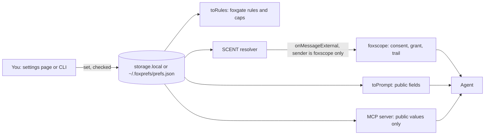
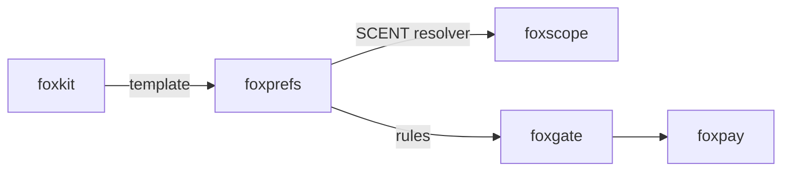

# foxprefs

[](https://www.npmjs.com/package/foxprefs)
[](https://www.npmjs.com/package/foxprefs)
[](https://opensource.org/license/mit)

[Quickstart](#set-your-first-preference) · [API reference](#runtime-surfaces) · [Coverage](#coverage) · [FAQ](#faq)

foxprefs is an open-source library, CLI, MCP server and Firefox extension for typed personal preferences.
You write "size M, vegetarian, never over 200 USD" once, and each agent reads only the fields you allow.
The values stay in your browser or in a file on your computer.

## Install

```bash
npm install foxprefs
```

The package needs Node.js 24 or later and includes TypeScript declarations.
It has two runtime dependencies, `@modelcontextprotocol/sdk` and `zod`, for the MCP server.
The Firefox extension needs Firefox 153 or later.

## Set your first preference

Save this as `example.mjs`, then run `node example.mjs`.
It keeps the values in memory. No keys, environment variables or `.env` file are needed.

```js
import { createPrefs, memoryStore } from "foxprefs";

const prefs = createPrefs({ store: memoryStore() });
await prefs.set("shopping.size.top", "M");
await prefs.set("food.diet", "vegetarian");
await prefs.setText("budget.perPurchase", "80 USD");
await prefs.setText("rules.maxPurchase", "200 USD");
await prefs.set("travel.loyalty", ["Aeroplan 123456789"]);

console.log(await prefs.toPrompt());
console.log(await prefs.get(["budget.perPurchase"], { derive: true })); // { 'budget.perPurchase': 'mid' }
await prefs.set("food.diet", "carnivore").catch((e) => console.log(e.code)); // bad-value
```

The prompt text has the size, the diet and the hard rule.
It has no budget (an "ask" field) and no loyalty number (a private field).

From a shell, the same store is a file:

```bash
npx foxprefs set shopping.size.top M
npx foxprefs set rules.maxPurchase 200 USD
npx foxprefs prompt
```

## How it works



1. Each field has a type (`enum`, `string`, `number`, `list`, `boolean`, `money`) and a
   sensitivity: `public`, `ask` or `private`. You can change the sensitivity of any field.
2. `set` checks the value against its field. A bad value throws `bad-value` and the store
   does not change. Text values must be one line, so a value cannot add a line of its
   own to an agent prompt.
3. Public fields go to agents through the prompt text and the MCP server.
4. An `ask` field goes out only through [foxscope](https://github.com/pooriaarab/foxscope),
   which asks you first and logs each read. foxprefs answers SCENT messages from the
   foxscope extension and from no other extension.
5. A private field never leaves: no agent surface returns it, also with `derive`.
6. `derive: true` gives the smaller answer: the budget band `low`, `mid` or `high`
   instead of the amount.

## Why it exists

People type the same facts into every chat, and each chat forgets them or keeps them in its own account.
[ChatGPT custom instructions](https://help.openai.com/en/articles/8096356-chatgpt-custom-instructions) keep free text for one product.
The [Human Context Protocol](https://digitaleconomy.stanford.edu/project/loyal-agents/hcp-human-context-protocol/) describes portable preferences with consent, but has no published schema yet.
foxprefs is a small typed version that you run yourself, with a level per field.

## Compare

Checked on 2026-10-15 against the linked pages.

| Item | foxprefs | ChatGPT custom instructions | HCP demo ([tobinsouth/hcp-demo](https://github.com/tobinsouth/hcp-demo)) |
|---|---|---|---|
| Where data lives | Your browser or a local file | The product account | Demo server |
| Shape | Typed fields with checks | Free text | Free key-value context |
| Per-field access | `public`, `ask`, `private` | None | `Allow`, `Ask`, `Never` |
| Agents | Any, through text, MCP or SCENT | One product | MCP and REST |

## Coverage

| Surface | Status | How it is checked |
|---|---|---|
| Library (`foxprefs`) | Implemented | 56 vitest tests |
| File store (`foxprefs/node`) | Implemented | vitest |
| CLI (`foxprefs`) | Implemented | vitest, run in process |
| MCP server (`foxprefs mcp`) | Implemented | vitest with the SDK in-memory client |
| foxgate rules (`toRules`) | Implemented | A real foxgate 0.1.6 enforces them in a test |
| Firefox extension | Implemented | E2E on Ichabod (remote Firefox 157), 26 checks |
| SCENT with the real foxscope | Not tested | foxscope is not released yet; a stand-in with its id is used |
| HCP export (`toHcp`) | Implemented, shape `foxprefs/hcp-v0` | vitest; there is no official schema to check against |

## Runtime surfaces

### Library

| Export | What it does |
|---|---|
| `createPrefs({ store, schema?, now? })` | Returns the prefs object below. |
| `memoryStore()`, `storageAreaStore(area, key?)` | Stores in memory, or in a WebExtension area such as `browser.storage.local`. |
| `DEFAULT_SCHEMA`, `GROUPS`, `defineSchema(fields)` | The shipped fields, and a check for your own schema. |
| `validateValue`, `parseValue`, `formatValue`, `formatMoney` | Check a value, read it from text, write it as text. |
| `prefsResolver(prefs)` | The SCENT v0.1 resolver for the `prefs` namespace. |
| `answerScent(resolver, sender, message)` | The extension's `onMessageExternal` answer. `undefined` for any sender but `foxscope@pooriaarab`. |
| `FoxprefsError` | Has a `code`: `unknown-field`, `bad-value`, `bad-schema`, `bad-store`, `bad-import`, `too-large`, `bad-request`. |

The prefs object:

| Method | What it does |
|---|---|
| `get(fields, { derive? })` | Values of the fields that have one. This is the owner's call, so private fields are in it. |
| `set(field, value)` / `setText(field, text)` | Check and store a value. `setText` reads `200 USD`, `yes`, `a, b`. |
| `unset(field)`, `setSensitivity(field, level)` | Remove a value, change who can read a field. |
| `all()` | Every field with its label, type, sensitivity and value. |
| `export()` / `import(json)` | The whole record in the `foxprefs/v1` format. An import is checked whole first; a bad one changes nothing. |
| `toPrompt(fields?)` | Plain text for a system prompt. Public fields only. |
| `toRules()` | `{ maxPerPurchase, payGrant, userRules, neverShare }` in foxgate formats. |
| `toHcp()` | An export in the spirit of HCP: context, per-field `Allow`/`Ask`/`Never`, and sentences. No private values. |

Money is `{ value, currency }` in whole minor units (cents for USD), the same as foxgate.

### The default fields

| Group | Fields |
|---|---|
| `identity` | `name` (ask), `pronouns`, `language`, `timeZone` |
| `shopping` | `size.top`, `size.bottom`, `size.shoe`, `brands.avoid`, `materials.avoid` |
| `food` | `diet`, `allergies` (ask), `dislikes` |
| `travel` | `seat`, `airlines.prefer`, `redeye`, `loyalty` (private) |
| `budget` | `perPurchase` (ask, derives a band), `monthly` (ask, derives a band) |
| `communication` | `tone`, `length`, `format` |
| `accessibility` | `textSize`, `reducedMotion`, `captions` |
| `rules` | `maxPurchase`, `neverShare`, `sites.block`, `sites.ask` |

Fields without a note are public. The band for one purchase is under 50, under 250, or more,
in the major unit of the currency. The monthly band is under 500, under 2000, or more.

### foxgate rules

```js
import { createFoxgate } from "foxgate";

const rules = await prefs.toRules();
const { gate, host } = createFoxgate({ tools: { buy: { scope: "pay", amount: (a) => a.amount } }, publicSuffix });
if (rules.payGrant) await host.addGrant({ ...rules.payGrant, domains: ["shop.example"] });
for (const rule of rules.userRules) await host.addRule(rule);
```

- `payGrant` is the monthly budget as a foxgate spend cap. It ends at the start of the next month (UTC).
- `userRules` deny `read` and `submit` on `rules.sites.block`, and ask for `submit` on `rules.sites.ask`.
  foxgate needs registrable domains here (`example.com`, not `shop.example.com`).
- foxgate has no per-action cap, so check `maxPerPurchase` in your executor.
- A field that you made private is left out of the rules.

### CLI

```text
foxprefs set <field> <value>        foxprefs get <field...> [--derive]
foxprefs list                       foxprefs unset <field>
foxprefs sensitivity <field> <public|ask|private>
foxprefs prompt [field...]          foxprefs rules
foxprefs export [--hcp]             foxprefs import <file>
foxprefs mcp
```

The store is `$FOXPREFS_HOME/prefs.json`, by default `~/.foxprefs/prefs.json`. The directory is
`0700` and the file `0600`. Exit codes: 0 done, 1 a bad value or store, 2 bad usage.

### MCP server

`foxprefs mcp` serves three read-only tools over stdio:

| Tool | What it returns |
|---|---|
| `prefs_list_fields` | Names, labels, sensitivities. No values. |
| `prefs_get` | `{ status: "ok", value }` for public fields. `needs-grant` for ask fields, `private` for private ones, never the value. |
| `prefs_prompt` | The `toPrompt()` text. |

```json
{ "mcpServers": { "foxprefs": { "command": "npx", "args": ["foxprefs", "mcp"] } } }
```

### Firefox extension

- The settings page has a row per field, a level select per field, export, import, and
  "Copy for an agent".
- The popup shows the most-used fields, the copy button, and "Fill my size". That button
  injects a script into the active tab only when you click it (`activeTab`), and sets size
  `<select>` controls whose option matches your size.
- `onMessageExternal` answers `{type: "scent.list"}` and `{type: "scent.read", fields, derive}`
  from `foxscope@pooriaarab` only. Any other extension gets the error that Firefox gives
  for an extension that is not installed.

```bash
pnpm install
pnpm build:ext    # dist-ext/; load it from about:debugging
pnpm e2e          # local Firefox, or FOXKIT_BROWSER=ichabod with ICHABOD_API_KEY
```

## Limits

- foxprefs keeps no grants and no log. Consent, expiry and the trail for `ask` fields are foxscope's job.
- Two CLI processes that write at the same time: the last write wins. There is no file lock.
- The budget bands do not know local prices. They use the amount in the major unit as is.
- `toPrompt` is text. An agent can still ignore it; foxgate rules are the part that is enforced.
- "Fill my size" reads only `<select>` controls with "size" in their name, id or label.
  Buttons, radio groups and custom widgets are not filled.
- An export file has every value, also the private ones. Keep it safe.
- No sync between devices. The extension and the CLI use separate stores; move data with export and import.

## Part of the fox primitives



## FAQ

### Can an agent change my preferences?

No. The MCP server has no write tool, and the extension answers writes from its own pages only.

### What does an agent see for an "ask" field?

Over MCP it sees "needs a grant: ask the user through foxscope". It sees the value only after you
approve a foxscope request for that field.

### Is the HCP export the official format?

No. The Human Context Protocol has no published schema yet. `toHcp()` follows the
`GrantOfAuthority` shape of the HCP demo and labels itself `foxprefs/hcp-v0`.

## License

[MIT](LICENSE)
